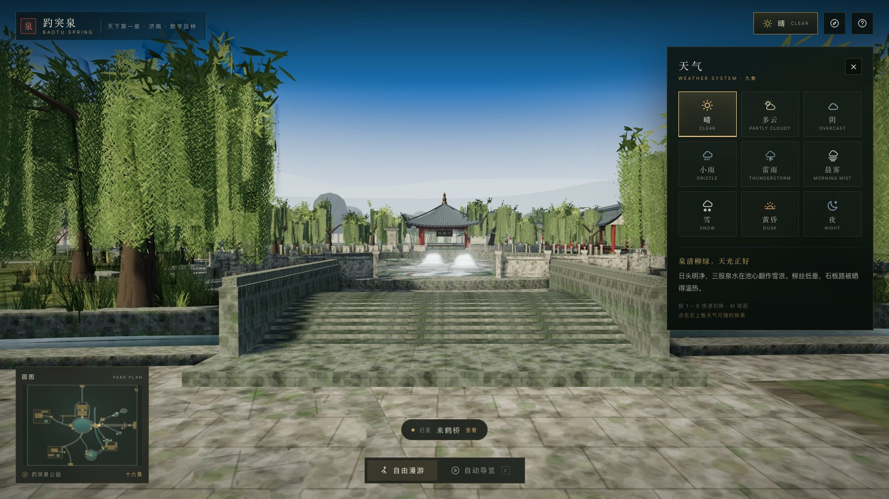
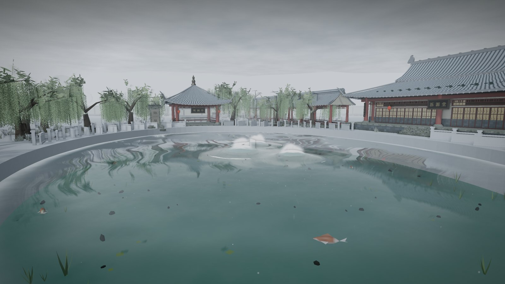
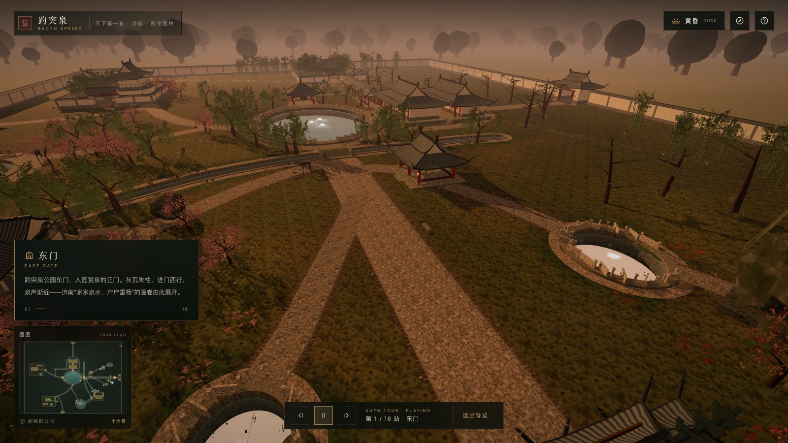
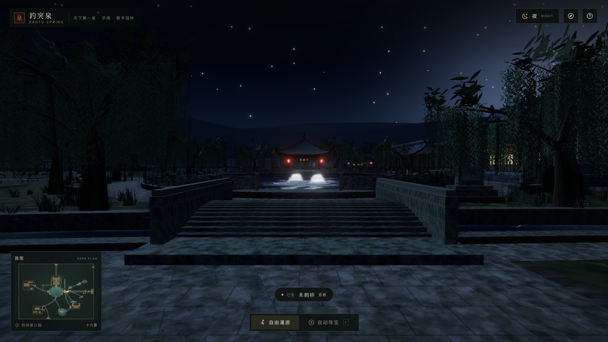
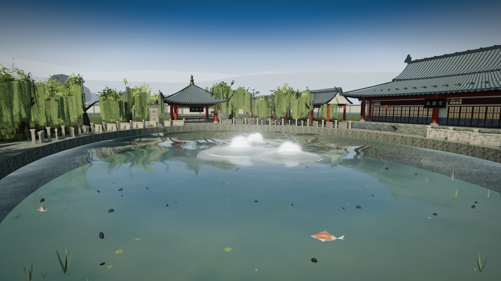
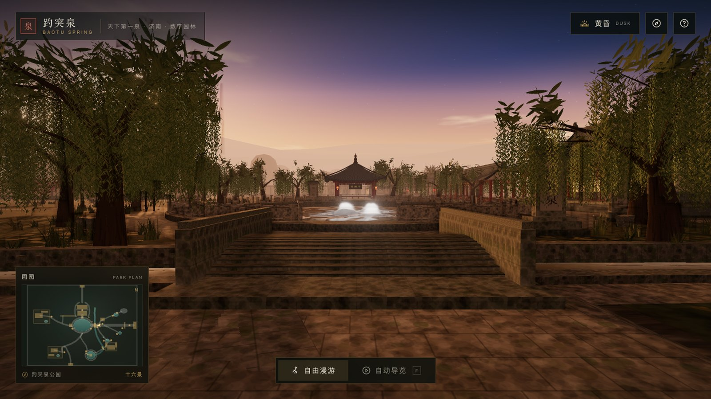
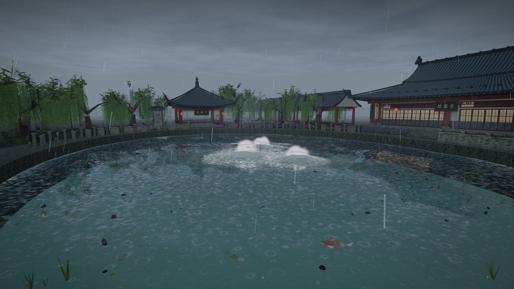
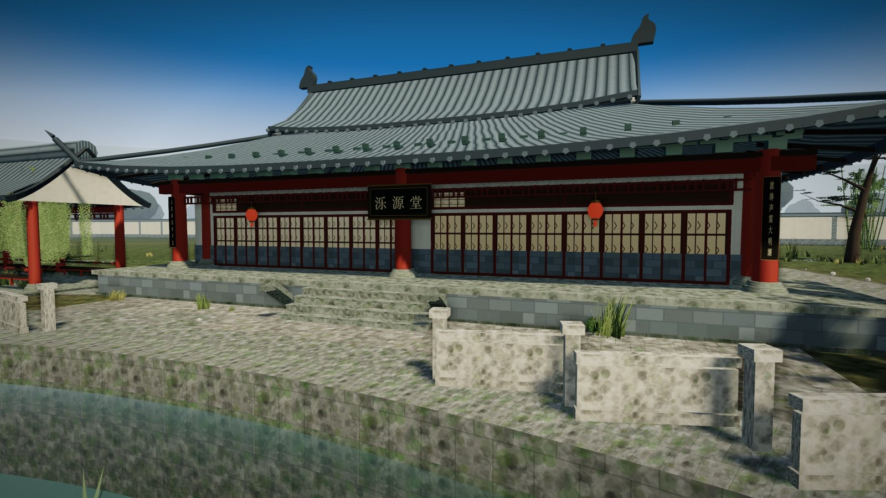
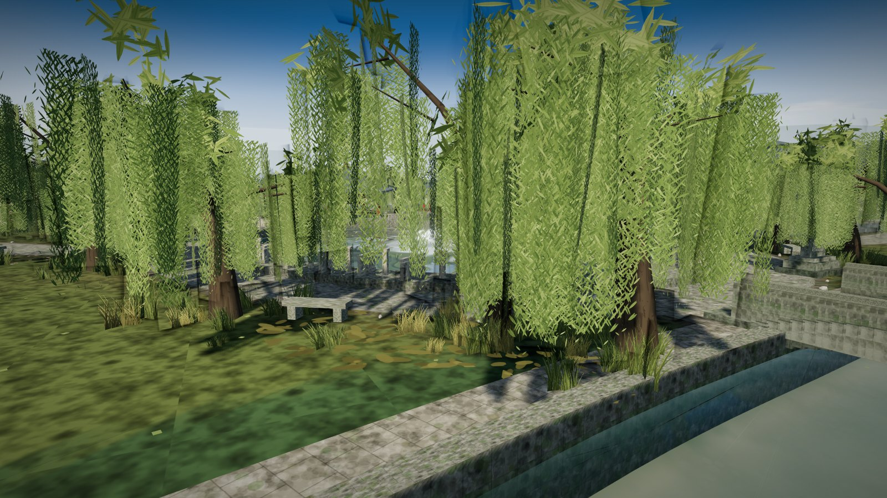
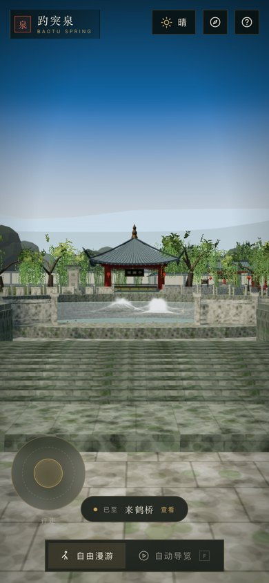

# 趵突泉 · 天下第一泉 —— 可游览 3D 数字园林

一座用 **React 19 + Three.js 0.186** 实时构建的、可以自由行走与自动导览的 3D 趵突泉公园。
全园几何、植被、建筑、水面、天空与天气粒子**全部程序化生成**，不依赖任何外部模型、贴图或 CDN。

**九种天气**（晴 / 多云 / 阴 / 小雨 / 雷雨 / 晨雾 / 雪 / 黄昏 / 夜）可随时切换，
天空、光照、雾、水面、雨雪粒子、水汽与灯笼光会随之平滑变化——尤其是雪天，泉水常年约 18℃，
池面腾起"云雾润蒸"的白汽，是这座园子最动人的一刻。



**在线游览**：https://rayzh0ng.github.io/baotu-spring-park/
（GitHub Pages，推送 `main` 自动部署）

---

## 快速开始

```bash
# 依赖已随项目安装（React / Three / Vite）
pnpm dev          # http://127.0.0.1:5174
pnpm build        # 生产构建到 dist/
pnpm preview      # 预览生产构建
```

> Node.js 20+，浏览器需支持 WebGL 2。
> 本地开发服务器地址：**http://127.0.0.1:5174**

---

## 怎么游览

| 操作 | 说明 |
| --- | --- |
| **W / A / S / D** 或方向键 | 步行游园 |
| **Shift** | 疾行 |
| **按住画面拖动** | 环顾四周（触屏单指拖动） |
| 单击画面 | 进入鼠标锁定视角（Esc 退出） |
| **F** | 切换「自由漫游 / 自动导览」 |
| **空格** | 导览中暂停 / 继续 |
| **1 – 9** | 快速切换九种天气 |
| **M** | 收起 / 展开天气面板 |
| **L** | 打开「园中十六景」列表 |
| **H** | 游园须知 |

- **自由漫游**：从东门内来鹤桥东侧的第一观泉点出发，一路可行至观澜亭、泺源堂、娥英祠、
  望鹤亭、马跑泉、金线泉、假山、荷风亭、漱玉泉、李清照纪念堂、万竹园与沧园。
  点击左下**园图**上的金点，或按 **L** 打开十六景列表，可直接瞬移前往。
- **自动导览**：16 站电影级航拍运镜，镜头在亭台泉石之间穿行、到站停留并显示景点题解。
- 移动端：左下虚拟摇杆行走，单指拖动环顾，天气面板变为底部抽屉。

---

## 九种天气

| 天气 | 氛围 | 主要变化 |
| --- | --- | --- |
| **晴** | 泉清柳绿，天光正好 | 暖阳、强阴影、天空高光、清透池水 |
| **多云** | 云影徘徊，水光潋滟 | 流云遮日、光比变柔、水面明暗流动 |
| **阴** | 云幕低垂，泉声愈清 | 低饱和冷灰、平光、雾稍浓 |
| **小雨** | 细雨湿衣，泉眼无声 | 雨丝、水面涟漪、石面湿润变深、积水 |
| **雷雨** | 风起泉涌，雷动园林 | 大雨、狂风、闪电劈亮天空与泉池 |
| **晨雾** | 雾失楼台，泉声可寻 | 浓雾吞远、低角度暖光、泉上水汽 |
| **雪** | 泉暖雪落，云雾润蒸 | 飘雪、地面/屋顶/树冠积雪、泉池蒸腾白汽 |
| **黄昏** | 泉上熔金，柳梢落日 | 低角度金色逆光、暖调天空、灯笼初上 |
| **夜** | 月照泉心，灯暖亭台 | 星空银河、月光冷调、灯笼暖光、水面月光反射 |



---

## 园中十六景

东门 · 天下第一泉牌坊 · 来鹤桥 · 趵突泉 · 观澜亭 · 泺源堂 · 娥英祠 · 望鹤亭 ·
马跑泉 · 金线泉 · 假山 · 荷风亭 · 漱玉泉 · 李清照纪念堂 · 万竹园 · 沧园

十六处均按史料与实景意象重构，并配有简明题解（见 `src/data/pois.js`）。



| 夜 | 泉池 |
| --- | --- |
|  |  |

| 黄昏 | 雷雨 |
| --- | --- |
|  |  |

| 建筑细节 | 柳岸草地 |
| --- | --- |
|  |  |

| 移动端 |
| --- |
|  |

---

## 技术实现

### 场景结构

```
src/
  App.jsx                  UI 外壳（加载页 / HUD / 天气面板 / 景点卡 / 小地图 / 摇杆）
  data/
    weather.js             9 种天气预设（env 目标值 + UI 文案）—— 天气系统的唯一数据源
    pois.js                16 个景点（步行机位 / 导览机位 / 题解 / 游线顺序）
  three/
    layout.js              权威布局：水面形状、道路、高差、围墙、建筑、种植分区、碰撞辅助
    engine.js              renderer / camera / 自适应分辨率
    experience.js          编排：天气 → 场景 → 控制 → 渲染，并暴露 window.__park
    park.js                场景合成器（各 world 模块 try/catch 隔离）
    core/env.js            每帧环境状态（光照/天空/雾/雨雪/风/温湿度）
    world/
      terrain.js           地面开洞 + 池底/池壁 + 石路 + 石栏 + 天气材质
      water.js             水面 shader（合并 1 draw call）+ 泉眼水花 + 水汽 + 锦鲤
      buildings.js         建筑总装（门 / 堂 / 亭 / 楼 / 廊 / 桥 / 碑 / 假山 / 院墙）
      arch/                建筑构件库（屋顶曲面、斗拱、瓦当、匾额、栏杆…）
      vegetation.js        植被总装（柳 / 竹 / 松 / 海棠 / 枫 / 地被 / 荷 / 芦苇）
      plants/              植物几何、程序化贴图、风摆着色器、种植算法
      props.js             石灯笼 / 石狮 / 茶座 / 指路牌 / 长椅 / 小舟 / 盆景
      sky.js               天空穹顶 shader（云 / 日 / 月 / 星空 / 闪电）+ 灯光与阴影
      outer.js             园外地形、远山剪影与树线（天际线层次）
    systems/
      weather.js           天气插值（2.2s 平滑过渡）+ 雷电
      particles.js         雨 / 雪 / 雾 / 萤火 / 落叶（GPU 循环，跟随玩家）
    controls/
      walker.js            第一人称行走：碰撞 / 高差 / 头动 / 触屏
      tour.js              自动导览：弧线航拍运镜 + 停留 + 景点回调
```

### 关键设计

- **唯一权威布局**：`layout.js` 提供水面形状、道路折线、高差场 `heightAt()`、建筑与种植分区，
  各模块共享同一套坐标，保证"看起来是一体的"。
- **真实的地面开洞**：主泉池、溪流、荷花池、各小泉在地面上挖出真实洞口，
  池底有程序化卵石 / 水草 / 焦散，池壁石砌，水面独立渲染——所以泉水是"清冽见底"的。
- **三股泉水**：水面 shader 里做水丘位移与白沫，配合水花粒子、池底气泡与扩散波纹，
  形成"趵突腾空"的翻涌感；雪天叠加 `env.steam` 的"云雾润蒸"。
- **天气驱动一切**：`env` 是唯一的跨模块状态（光、雾、天空色、雨雪风、温湿度、夜色），
  天气系统平滑插值，各模块在自己的 `update(dt, env)` 里响应（积雪、湿润、风摆、灯笼自发光）。
- **光影系统**：
  - **平面反射**：镜像虚拟相机 + 斜裁剪平面，把亭台、树木、灯笼真实映在水面上；
    半分辨率 + 隔帧更新，水面 shader 按屏幕 UV 采样并做竖向拉丝模糊与法线扰动。
  - **天空 IBL**：把天空穹顶烘成 cube map + PMREM，作为 `scene.environment` 给所有
    PBR 材质提供环境反射与补光，随天气/时间节流重烘。
  - **SSAO**：屏幕空间环境光遮蔽，为檐下、石阶、树根、亭柱补上接触阴影
    （不使用 GTAO —— 其 GBuffer 法线会与透明水面产生放射状伪影）。
  - **软阴影**：2048 阴影贴图 + PCF 软边，阴影相机跟随玩家（104m 覆盖），
    阴影强度随雨/雪/雾/夜色自动衰减。
  - **Bloom**：高光溢出，夜晚与黄昏加强，阴雨收敛。
  - 三者统一走 `EffectComposer → OutputPass` 做一次 ACES 色调映射。
- **抗锯齿（三层）**：
  - EffectComposer 主 RT 开 **4× MSAA**（WebGL2 multisampled）——默认 RT 不带 MSAA，几何边缘会明显锯齿；
  - 几何边缘由 MSAA 处理，着色器内边缘（植被 alphaTest、水面法线扰动）再由 **SMAA** 在 OutputPass 之后做边缘检测与混合；
  - 自适应 DPR（0.8×–2×）在低帧率设备上兼顾清晰度与流畅度。
- **植被风摆（GPU 顶点动画）**：
  - 共享风钟 + **阵风包络**（低频起伏，风一阵一阵地吹）+ 缓慢转动的**风向**；
  - 三种运动模式：`upright`（草/芦苇：根部固定、越高越摆，低频倒伏 + 中频摆动 + 高频颤动，并带垂直于风向的横向扭动）、
    `hanging`（柳条：越靠下摆幅越大，叶片沿枝条轻微扭转）、`rigid`（叶簇/树冠：整簇轻摆 + 扭转）；
  - 每株植物按世界坐标取相位，整片不会同步摆动；所有材质共用 uniform，CPU 侧每帧只写几个标量。
- **植被与地表细节**：
  - 草簇 ~1,500 株（三张交叉卡片 + 随机倾斜 + 256px 程序化草叶贴图，带根部到叶尖渐变与叶脉高光）；
  - 柳帘贴图 256×768 / 14 条柳丝，卡片细分 10 段保证风摆曲线顺滑；竹 1,876 根竹竿；
  - 台阶增加踏面石鼻（阴影线）、踏面石缝与两侧垂带石，近看有明显构造层次。
- **性能**：建筑按材质合并、植被与小品 InstancedMesh、水面合并为 1 个 draw call、
  天空穹顶 1 个 draw call；自适应 DPR；主渲染约 **175 draw calls / 92 万三角面**，
  含 MSAA、反射、SSAO 与后处理约 345 次/帧。
- **无外部资产**：所有贴图（木纹、石纹、瓦、窗棂、叶簇、荷叶、匾额、碑刻）都用 Canvas 2D 程序化绘制。

### 调试参数（便于截图 / 排障）

```
?weather=sunny|cloudy|overcast|drizzle|storm|mist|snow|dusk|night
?mode=tour|walk        ?poi=<景点id>        ?panel=0      ?ui=0
?cam=x,y,z&look=x,y,z  ?t=<秒>              ?quality=high|low
?fx=0（关闭全部新特效） / ?fx=refl,ibl,post（单独调试）
```

页面暴露 `window.__park`：`setWeather(id)` / `setMode()` / `teleportToPoi(id)` /
`step(seconds)`（确定性快进，截图用）/ `getStats()`。

截图工具：`node scripts/shot.mjs --url "http://127.0.0.1:5174/?weather=snow" --out shot.png`

---

## 说明

这是一座**写意重建**的数字园林，用于呈现趵突泉的泉水、建筑与四时天气之美，
并非测绘级复刻；建筑尺度、景点相对位置做了艺术化处理。景点题解参考公开资料撰写。

> 「设若没有这泉，济南定会丢失一半的美。」—— 老舍《趵突泉的欣赏》
